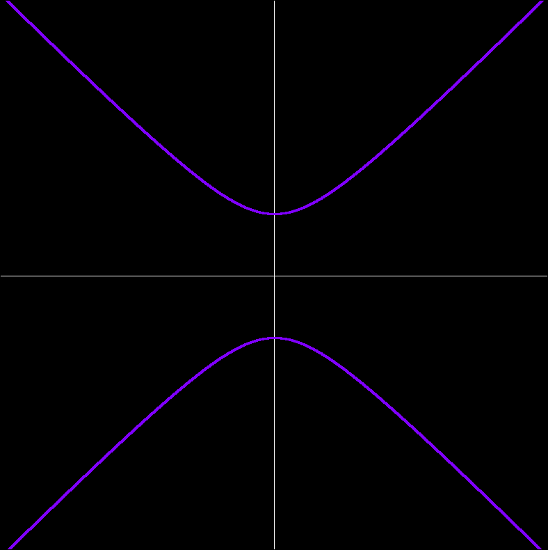

# Hyperbole Visualizer
A vertical hyperbole visualizer built in openGL



# Requirements
This project requires:
- `openGL 4.4 core` support
- `GLSL 4.4 core` support
- `gcc 10` / `clang 10` or higher
- `cmake 4.4.4` or higher
- `make 4.4.x` or higher
- `GLFW 3.x.x`
- `glm 1.0.3` or higher

# Compile and Run
Go into the `src` directory and run:

```fish
cmake -B build
cd build
make
```

Once the program is compiled, run it with:
```fish
./hgc
```
